# Defensa — Integrante 1: Seguridad + Panel Admin

Machete para exponer. Cada sección tiene: diagrama, archivo clave, qué decir y la pregunta típica con su respuesta corta.

> Los diagramas están en Mermaid. Se ven en GitHub, GitLab y en VS Code/Kiro con la extensión "Markdown Preview Mermaid Support".

---

## Índice

1. [Mapa general](#1-mapa-general)
2. [Login](#2-login)
3. [CuentaActivaInterceptor](#3-cuentaactivainterceptor)
4. [Redirección por rol y activación de cuenta](#4-redirección-por-rol-y-activación-de-cuenta)
5. [@UnidadDelResponsable](#5-unidaddelresponsable--argument-resolver)
6. [Alta de Unidad de Venta + Responsable](#6-alta-de-unidad-de-venta--responsable)
7. [darDeAlta + Observer (mail)](#7-dardealta--observer-mail)
8. [Estados de la unidad](#8-estados-de-la-unidad-pendiente--habilitada)
9. [Alta de empleados](#9-alta-de-empleados)
10. [Baja lógica](#10-baja-lógica)
11. [Alta de platos](#11-alta-de-platos)
12. [Ranking y mayor canon](#12-ranking-y-mayor-canon)
13. [Polimorfismo del canon](#13-polimorfismo-del-canon)
14. [Factory](#14-factory)
15. [Validaciones custom](#15-validaciones-custom)
16. [Preguntas rápidas](#16-preguntas-rápidas)
17. [Tabla resumen](#17-tabla-resumen)

---

## 1. Mapa general

Recorrido de un request desde que llega hasta que responde.

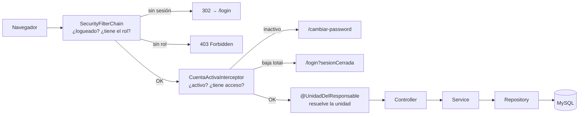


---

## 2. Login

**Archivos:** `SecurityConfiguration.java`, `UsuarioDetailsService.java`

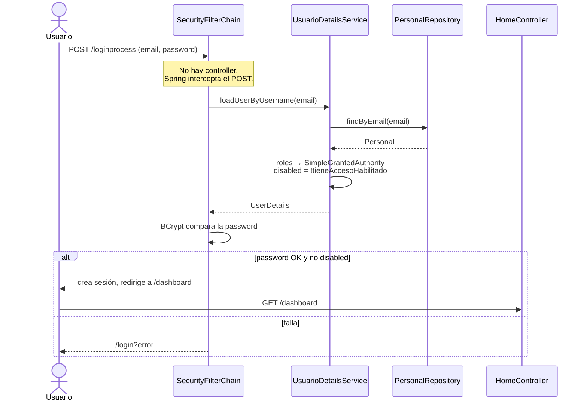

### Reglas de autorización

```java
auth.requestMatchers("/admin/**").hasRole("ADMIN");
auth.requestMatchers("/responsable/**").hasRole("RESPONSABLE");
auth.requestMatchers("/empleado/**").hasAnyRole("EMPLEADO", "RESPONSABLE", "ADMIN");
auth.anyRequest().authenticated();
```

### Qué decir

- `hasRole("ADMIN")` busca la authority `ROLE_ADMIN`. Spring agrega el prefijo `ROLE_` solo. Por eso la tabla `rol` guarda `ROLE_ADMIN`, `ROLE_RESPONSABLE`, `ROLE_EMPLEADO` (constantes en `Roles.java`).
- Sin sesión → 302 a `/login`. Con sesión pero sin rol → 403.
- `loginProcessingUrl("/loginprocess")`: Spring atiende ese POST sin controller.
- Logout: POST a `/logout` → invalida sesión → `/login?logout`.
- **Contra `main`:** allá había `NoOpPasswordEncoder` (texto plano) y CSRF deshabilitado. Acá BCrypt y CSRF activo (el default).

### `tieneAccesoHabilitado`

```java
return !personal.requiereUnidadActiva()
        || asignacionStaffRepository.existsByPersonalIdAndEliminadoFalse(personal.getId());
```

- `requiereUnidadActiva()` es `false` por defecto → admin y responsable siempre entran.
- `Empleado` lo redefine a `true` → necesita al menos una asignación no eliminada.

> **Pregunta:** "¿De dónde saca Spring los usuarios?"
> **Respuesta:** De `loadUserByUsername`. Recibe el email del formulario, busca el `Personal`, convierte sus roles en authorities y devuelve un `UserDetails`. Si el empleado está dado de baja en todas sus unidades, lo marca `disabled` y Spring lo rechaza aunque la contraseña sea correcta.

---

## 3. CuentaActivaInterceptor

**Archivos:** `CuentaActivaInterceptor.java`, `WebConfiguration.java`

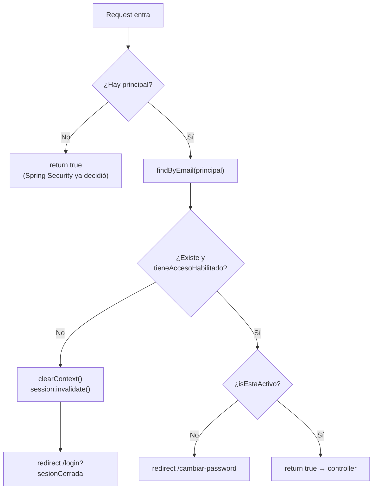

### Qué decir

- Corre **antes de cualquier controller, en cada request**.
- Dos chequeos:
  1. **Cuenta inactiva** → `/cambiar-password`. El usuario nuevo entra con la contraseña del mail y está obligado a elegir la suya. Así se confirma que el email es suyo.
  2. **Email cambiado o baja en todas las unidades** → cierra la sesión y manda a `/login?sesionCerrada`.
- Se registra excluyendo `/cambiar-password`, `/login`, `/logout`, `/`, `/error` y estáticos. Si no se excluyera `/cambiar-password`, el usuario inactivo entraría en un loop de redirecciones.

> **Pregunta:** "¿Por qué interceptor y no un chequeo en cada controller?"
> **Respuesta:** Porque si está en cada controller, alguno se olvida y el usuario lo saltea escribiendo la URL. Ese era el problema #1 del `main`: `estaActivo` solo se miraba en `/dashboard`, y entrando directo a `/empleado/perfil` se pasaba igual.

---

## 4. Redirección por rol y activación de cuenta

**Archivos:** `HomeController.java`, `PasswordController.java`, `CuentaService.java`

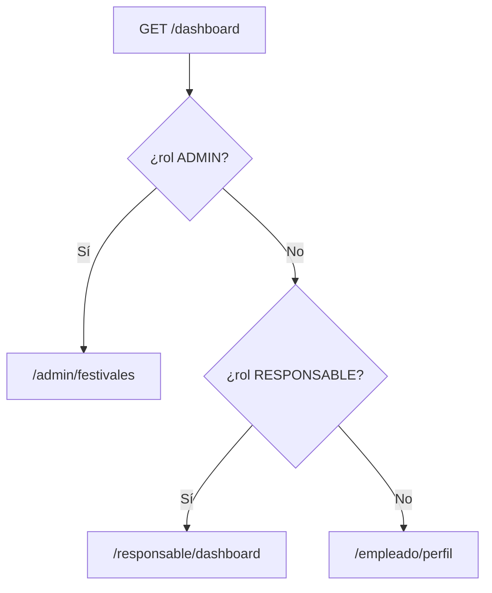

- En `/dashboard` no hace falta mirar `estaActivo`: el interceptor ya lo hizo.

### Activación (`POST /cambiar-password`)

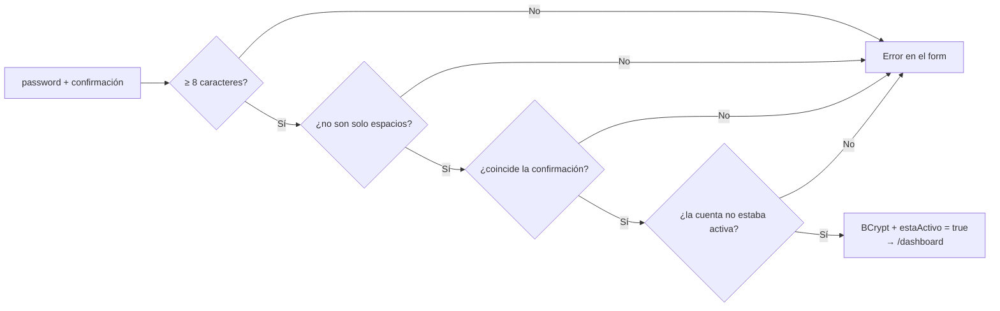

---

## 5. @UnidadDelResponsable — argument resolver

**Archivos:** `UnidadDelResponsable.java`, `UnidadDelResponsableResolver.java`, `UnidadVentaService.buscarUnidadDelResponsable`

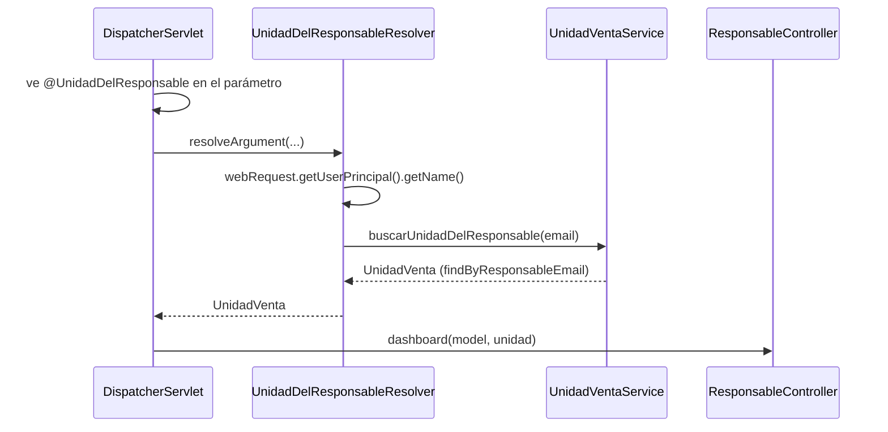

```java
@GetMapping("/dashboard")
public String dashboard(Model model, @UnidadDelResponsable UnidadVenta unidad) { ... }
```

### Qué decir

- El controller recibe la unidad sin saber nada del login.
- La búsqueda por email vive en **un solo lugar**.
- **Por qué importa:** en `main` el responsable veía todo el personal del sistema. Ahora cada operación recibe su unidad y no puede tocar la de otro.

> **Pregunta:** "¿Cómo sabe el responsable cuál es su unidad sin pasar el ID?"
> **Respuesta:** El resolver toma el email del usuario logueado y busca la unidad que tiene ese responsable. El ID nunca viaja en la URL, así que no se puede falsificar.

---

## 6. Alta de Unidad de Venta + Responsable

**Archivo:** `UnidadVentaService.crearUnidadVenta` (`@Transactional`)

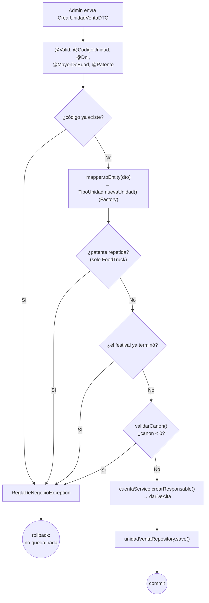

**Frase clave:** "Todo es `@Transactional`. Si falla cualquier paso, no queda ni la unidad ni el responsable a medio guardar."

---

## 7. darDeAlta + Observer (mail)

**Archivos:** `CuentaService.darDeAlta`, `CredencialesGeneradasEvent`, `EmailService`

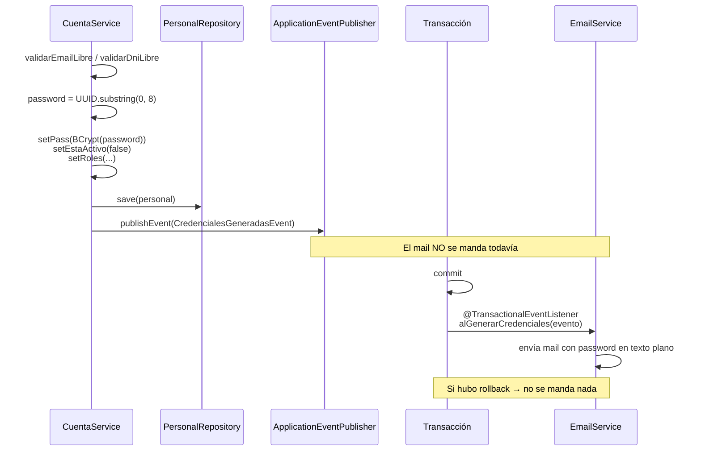

### Qué decir

- Contraseña aleatoria de 8 caracteres. En la base va **con BCrypt**; en texto plano solo viaja en el mail.
- `estaActivo = false`: entra, pero el interceptor lo manda a elegir su contraseña.
- El evento es un `record` simple: `(email, nombre, password)`.
- Si el mail falla, se loguea y el alta **no** se deshace. El responsable puede pasarle la contraseña a mano.

> **Pregunta:** "¿Por qué `@TransactionalEventListener` y no `@EventListener`?"
> **Respuesta:** Porque se ejecuta después del commit. Si el alta hace rollback, no mandamos credenciales de un usuario que no existe. `fallbackExecution = true` hace que corra igual cuando no hay transacción (por ejemplo, en tests).

---

## 8. Estados de la unidad: Pendiente → Habilitada

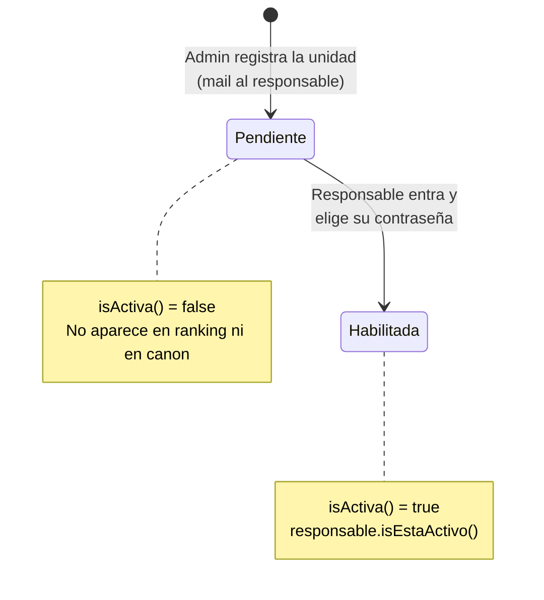

```java
public boolean isActiva() {
    return responsable != null && responsable.isEstaActivo();
}
```

---

## 9. Alta de empleados

**Archivo:** `EmpleadoService.crearEmpleado` / `incorporarEmpleado`

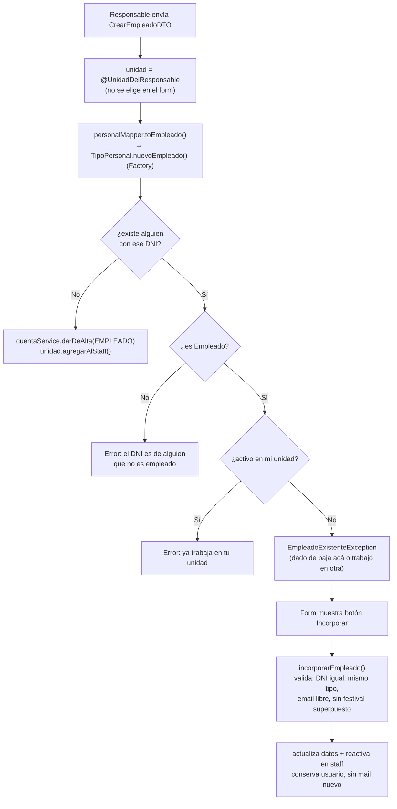

> **Pregunta:** "¿Por qué no creás otro usuario si el DNI ya existe?"
> **Respuesta:** Porque es la misma persona. Si Martín trabajó en el Puesto en 2024 y ahora lo quiere el Food Truck, se lo incorpora: conserva su usuario, se actualizan sus datos y queda activo en la nueva unidad.

---

## 10. Baja lógica

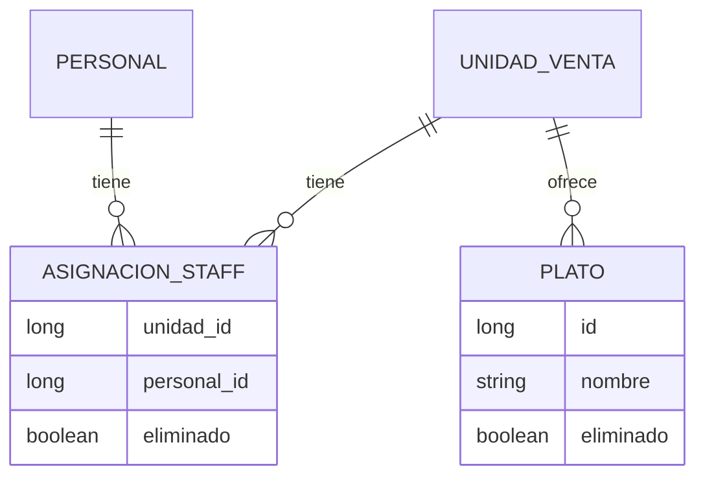

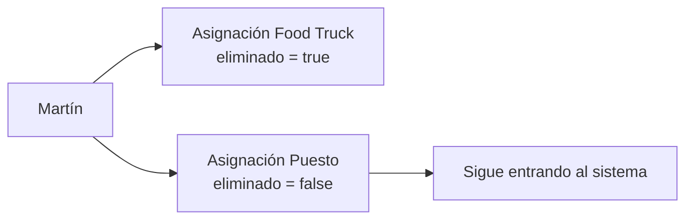

### Qué decir

- La baja marca `eliminado = true` en `AsignacionStaff` (la relación unidad-empleado), **no** en `Personal`.
- Es **por unidad**: si lo dan de baja en una, sigue activo en la otra. Solo pierde acceso si está dado de baja en **todas**.
- No se borra porque el empleado tiene historial: festivales, pedidos, recibos.

> **Pregunta:** "¿Por qué baja lógica?"
> **Respuesta:** Un borrado físico se lleva el historial (pedidos, recibos, festivales trabajados). Con la marca, la baja se puede revertir y los reportes viejos siguen cerrando.

---

## 11. Alta de platos

**Archivo:** `PlatoService.crearPlato`

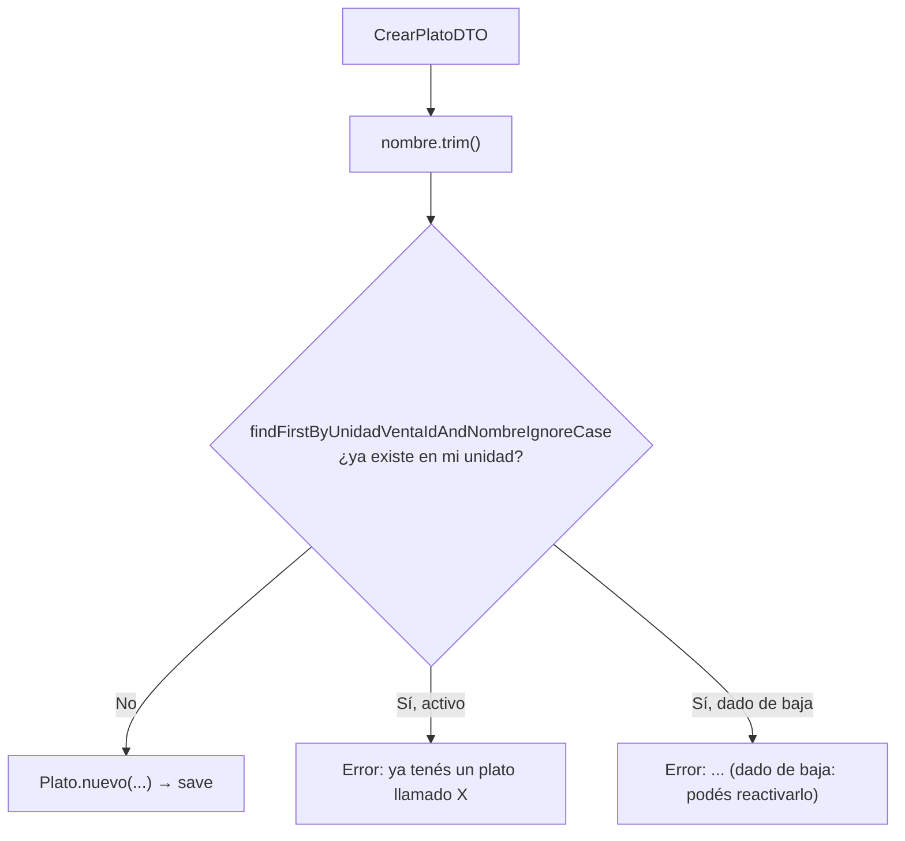

- El nombre se compara sin importar mayúsculas.
- `plato.darDeBaja()` / `plato.reactivar()`.
- Un plato dado de baja **no se ofrece en pedidos nuevos**, pero **sus ventas viejas siguen contando** en los reportes.

---

## 12. Ranking y mayor canon

**Archivo:** `UnidadVentaService`

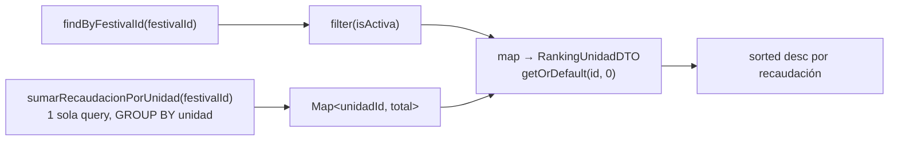

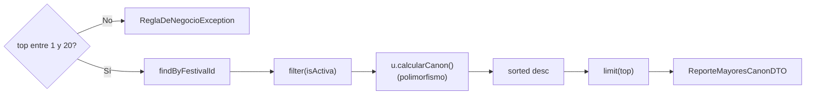

### Qué decir

- Ranking: un `Map` armado con **una sola query** evita hacer N consultas (una por unidad).
- Las unidades pendientes no aparecen: todavía no pueden vender.
- `ReporteMayoresCanonDTO` cubre el requisito grupal de "al menos un DTO de reporte".

---

## 13. Polimorfismo del canon

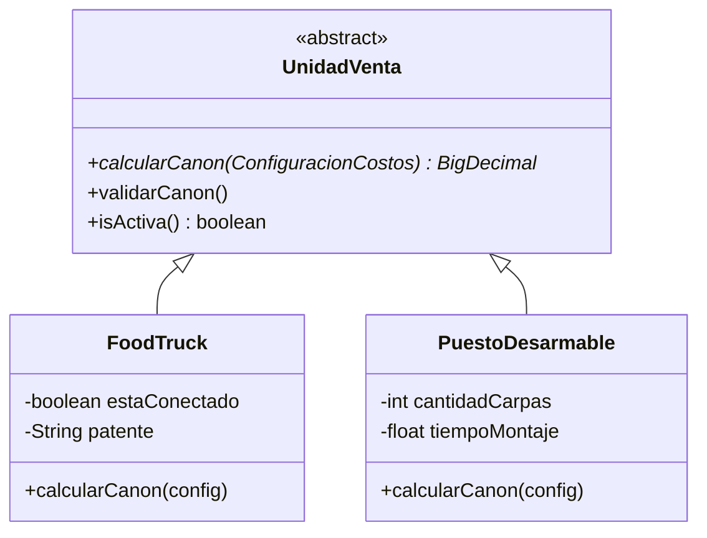

| Tipo | Fórmula |
|---|---|
| FoodTruck | `superficie × costoSuperficie` + `plusElectricidad` si está conectado |
| PuestoDesarmable | `superficie × costoSuperficie` − `tiempoMontaje × costoMontaje` |

- Sin `instanceof` ni `if (tipo == ...)`. El service llama `u.calcularCanon()` y no sabe qué tipo es.
- Agregar un tercer tipo no toca el service.
- `validarCanon()` rechaza canon negativo (ej.: puesto de 1 m² con 100 min de montaje → 500 − 1000 = −500).

---

## 14. Factory

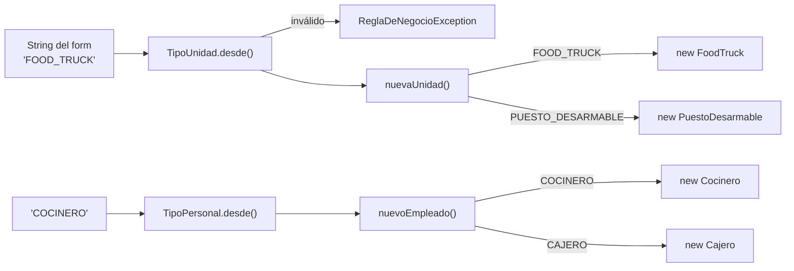

> **Pregunta:** "¿Por qué el enum crea las instancias?"
> **Respuesta:** Porque el enum es el tipo. Si el `switch` estuviera en el service, cada tipo nuevo obliga a acordarse de tocar el service. Así, el que sabe qué subclase corresponde es el propio tipo.

---

## 15. Validaciones custom

Cómo se arma un `ConstraintValidator` (sirve para todas):

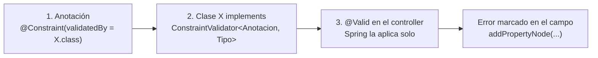

| Validación | Nivel | Regla | Dónde marca el error |
|---|---|---|---|
| `@CodigoUnidad` | Clase (DTO entero) | `^(FT\|PD)[A-Z0-9]{8}$` y el prefijo coincide con el tipo | `codigo` |
| `@Dni` | Campo | 7 u 8 dígitos | `dni` |
| `@MayorDeEdad` | Campo | nacimiento ≥ 18 años atrás | `fechaNacimiento` |
| `@Patente` *(Integrante 2)* | Campo | `ABC123` o Mercosur `AB123CD`; se normaliza (mayúsculas, sin espacios ni guiones) | `patente` |
| `@IngresoMayorDeEdad` *(Integrante 2)* | Clase (`FechasDeIngreso`) | ingreso no anterior a los 18 años | `fechaIngreso` |

- `@CodigoUnidad` es de clase porque necesita ver `tipoUnidad` para comparar el prefijo.

---

## 16. Preguntas rápidas

| Pregunta | Respuesta en una línea |
|---|---|
| ¿Cómo funciona la seguridad? | Cadena de filtros: autorización por URL, login por formulario sin controller, BCrypt y CSRF activo. |
| ¿Qué pasa si entro sin sesión? | 302 a `/login`. Con sesión y sin rol: 403. |
| ¿Por qué `ROLE_` en la base? | `hasRole("X")` busca la authority `ROLE_X`. |
| ¿Cómo se bloquea a un dado de baja? | `disabled` en `UserDetails` al loguear, y el interceptor le cierra la sesión si ya estaba adentro. |
| ¿Por qué el usuario nuevo no puede operar? | `estaActivo = false` hasta que elige su contraseña; el interceptor lo manda a `/cambiar-password`. |
| ¿Por qué interceptor? | Corre en cada request; no depende de acordarse en cada controller. |
| ¿Cómo evitás que un responsable toque otra unidad? | La unidad sale del usuario logueado (`@UnidadDelResponsable`), nunca de la URL. |
| ¿Cuándo se manda el mail? | Después del commit (`@TransactionalEventListener`). |
| ¿Qué pasa si falla el mail? | Se loguea; el alta queda hecha. |
| ¿Por qué las pendientes no salen en el ranking? | No pueden vender hasta que el responsable active la cuenta. |
| ¿Dónde está el polimorfismo? | `calcularCanon` abstracto, cada subclase su fórmula. |
| ¿Dónde está el Factory? | `TipoUnidad.nuevaUnidad()` y `TipoPersonal.nuevoEmpleado()`. |
| ¿Dónde está el Observer? | `CredencialesGeneradasEvent` publicado en `darDeAlta`, escuchado por `EmailService`. |
| ¿La baja es global? | No, es por unidad (`AsignacionStaff.eliminado`). |
| ¿Un plato dado de baja afecta reportes? | No; deja de ofrecerse en pedidos nuevos, sus ventas viejas siguen contando. |

---

## 17. Tabla resumen

| Tema | Archivo clave | Qué decir |
|---|---|---|
| Login | `SecurityConfiguration` | Cadena de filtros, autorización por URL, BCrypt, CSRF activo |
| UsuarioDetailsService | `UsuarioDetailsService` | Busca por email, roles → authorities, `disabled` si no tiene acceso |
| Interceptor | `CuentaActivaInterceptor` | Antes de todo controller; inactivo → `/cambiar-password`; baja → cierra sesión |
| Argument resolver | `UnidadDelResponsableResolver` | Resuelve la unidad del logueado; el service no sabe del login |
| Ranking | `UnidadVentaService.obtenerRankingPorFestival` | Filtra `isActiva`, una query + Map, orden descendente |
| Mayor canon | `UnidadVentaService.obtenerMayoresCanon` | Filtra `isActiva`, polimorfismo, top 1–20 |
| Polimorfismo | `FoodTruck` / `PuestoDesarmable` `.calcularCanon` | Sin `instanceof`, cada subclase su fórmula |
| Factory | `TipoUnidad.nuevaUnidad()` / `TipoPersonal.nuevoEmpleado()` | El enum crea la instancia |
| Observer | `CredencialesGeneradasEvent` + `EmailService` | Mail después del commit |
| Alta empleado | `EmpleadoService.crearEmpleado` | DNI repetido → `EmpleadoExistenteException` → incorporar |
| Baja lógica | `AsignacionStaff.eliminado` / `Plato.eliminado` | Por unidad, no global; marca, no borra |
| Validaciones | `CodigoUnidadValidator`, `PatenteValidator`, `IngresoMayorDeEdadValidator` | `ConstraintValidator` custom, error marcado en el campo |

---

## Orden sugerido para exponer (≈ 10 min)

1. Mapa general (sección 1) — 1 min
2. Login + interceptor (2 y 3) — 2 min
3. `@UnidadDelResponsable` (5) — 1 min
4. Alta de unidad + Observer + estados (6, 7, 8) — 2 min
5. Alta de empleados + baja lógica (9, 10) — 2 min
6. Ranking, canon, polimorfismo, Factory (12, 13, 14) — 2 min
7. Validaciones solo si preguntan (15)
